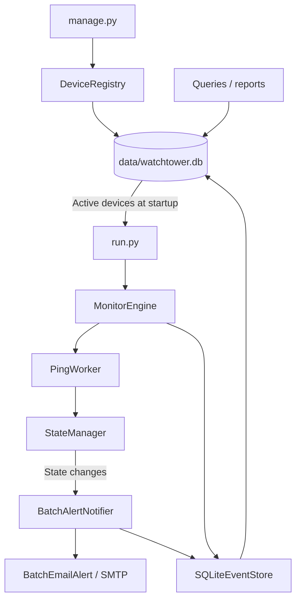

# Architecture

## Monitoring flow

1. `run.py` creates the event store, callbacks, notifier, and retention job.
2. The registry loads active devices from SQLite once at startup.
3. The engine schedules a check for each device.
4. The ping worker retries unsuccessful pings and returns a check result.
5. The engine saves the result, processes device state, and saves status.
6. State-change callbacks queue alerts; the engine records the transition.
7. The notifier batches changes, sends an email, and records the outcome.

Device registration is owned by `DeviceRegistry`. The runner uses
`SQLiteEventStore.update_device_status()` after checks and at shutdown; it does
not write registrations at startup. Status saves cannot change metadata or insert
rows and skip missing, inactive, or readdressed devices. Live target refresh is
still pending.

The scheduler executes check jobs sequentially. A slow or unreachable device can
delay checks for other devices, so the configured interval is not a strict timing
guarantee.

## States

| State | Meaning |
|---|---|
| UNKNOWN | Initial or reset state; no established result yet |
| UP | Responding under the current state-transition rules |
| DEGRADED | Responding with latency above the threshold |
| DOWN | Failure threshold reached |

Recovery and degradation edge cases still need work; see [[Known Issues]].

## Source map

| Path | Responsibility |
|---|---|
| `run.py` | Wires monitoring, persistence, notifications, and reports |
| `manage.py` | Device and history commands |
| `watchtower/monitor/engine.py` | Scheduling and callbacks |
| `watchtower/monitor/ping_worker.py` | ICMP checks and retries |
| `watchtower/monitor/state_manager.py` | Health transitions |
| `watchtower/storage/device_registry.py` | Device CRUD |
| `watchtower/storage/sqlite_event_store.py` | Events, status updates, cleanup |
| `watchtower/storage/queries.py` | Historical reporting |
| `watchtower/alerts/batch_notifier.py` | Batch collection and timing |
| `watchtower/alerts/batch_email_alert.py` | Email formatting and delivery |

The JSON-lines event store and individual-email notifier remain in the repository;
the runner uses SQLite and the batch notifier.

Related: [[Database]], [[Configuration]], [[Development and Testing]].
